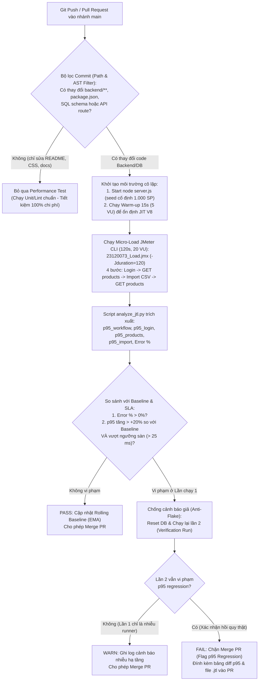

# HW05 – Performance Testing: Báo cáo kiểm thử hiệu năng

| Thông tin | Nội dung |
|---|---|
| **Họ và tên** | `Nguyễn Nam Phước` |
| **MSSV** | 23120073 |
| **Mã bài tập** | HW05-AI – Performance Testing |
| **Hệ thống kiểm thử (SUT)** | EShop – https://github.com/ttbhanh/eshop-sut |
| **Thành phần chạy** | Backend `node server.js` (`localhost:3000`) + giao diện quản trị `frontend-admin` (`localhost:5174`) |
| **Công cụ** | Apache JMeter 5.6.3 (OpenJDK 17.0.21), Windows Task Manager, DirectX Diagnostic Tool (`dxdiag`), AI (Antigravity) |
| **Máy chạy (`Hostname`)** | `PC-ADMIN` – HP Envy x360 15-fe0xxx, Intel Core i7-1355U (10 nhân / 12 luồng), 16 GB RAM, Windows 11 |

---

## Task 1 — AI-assisted test design and execution (Thiết kế và thực thi kiểm thử có AI hỗ trợ)

### 1.1. Thiết kế luồng kiểm thử end-to-end và các kịch bản với AI (Design and generate with AI)

#### A. Luồng kiểm thử end-to-end đã chọn (Scope)
**Luồng nghiệp vụ:** Admin đăng nhập → Xem danh sách sản phẩm → Import sản phẩm từ file CSV
*(Thuộc Pool A – FR-02, FR-05 và Pool C – FR-12, FR-15, FR-16)*

| Nhóm endpoint (theo đề) | Bước trong luồng | API trên Backend (`:3000`) | Lý giải cách luồng bao phủ nhóm endpoint |
|---|---|---|---|
| **Auth-heavy** | Bước `01`: Đăng nhập admin | `POST /api/login` | Tra cứu tài khoản theo email, kiểm tra trạng thái khoá (`locked_until`), ghi `UPDATE users SET login_attempts = 0` xuống SQLite mỗi lần đăng nhập thành công và ký chuỗi JWT (`jwt.sign`). |
| **Read-heavy** | Bước `02` & Bước `04`: Xem danh sách sản phẩm (trước và sau khi import) | `GET /api/products` | Thực hiện `SELECT * FROM products` (quét toàn bảng, **không phân trang**) để hiển thị bảng sản phẩm cho Admin và làm mới danh sách ngay sau khi import. |
| **Transactional** | Bước `03`: Import sản phẩm từ file CSV | `POST /api/admin/import-products` | Thực hiện giao dịch ghi hàng loạt (5 lệnh `INSERT INTO products` mỗi request) từ dữ liệu CSV đã chuyển thành mảng JSON. |

#### B. Mô tả 3 file kịch bản kiểm thử (`Load`, `Stress`, `Spike`) và tham số thiết kế

Cả 3 kịch bản đều thực thi cùng một luồng 4 bước ở trên và được đặt tên theo đúng quy ước `{StudentID}_{ScenarioType}_{YYYYMMDD}`:

| Kịch bản | File kịch bản (`.jmx`) | Cấu hình Thread / Virtual Users & Ramp-up | Think-time | Thời lượng | Lý giải lựa chọn tham số |
|---|---|---|---|---|---|
| **Load** | [test_plans/23120073_Load_20261122.jmx](test_plans/23120073_Load_20261122.jmx) | **1 Thread Group:** **20 VU**, ramp-up `60 s` | `2–5 s` trước đăng nhập;<br>`3–8 s` trước import CSV | `600 s` (10 phút) | Mô phỏng tải vận hành chuẩn với 20 quản trị viên thao tác đồng thời; thời gian suy nghĩ `2–8 s` phản ánh đúng nhịp độ người thật đọc bảng sản phẩm và chọn file CSV. |
| **Stress** | [test_plans/23120073_Stress_20261122.jmx](test_plans/23120073_Stress_20261122.jmx) | **5 Thread Group bậc thang** (mỗi bậc `120 s`, ramp-up `20–30 s`):<br>**10 → 25 → 50 → 100 → 200 VU** | `0,5–1,5 s` (rút ngắn để ép tải) | `600 s` (10 phút) | Tăng tải theo từng bậc gấp đôi để xác định chính xác **điểm gãy (knee / breaking point)** của tiến trình `node.exe` đơn luồng và cơ sở dữ liệu SQLite. |
| **Spike** | [test_plans/23120073_Spike_20261122.jmx](test_plans/23120073_Spike_20261122.jmx) | **2 Thread Group:**<br>• Nền: **10 VU** chạy suốt `360 s`<br>• Đột biến: tại `t = 120 s`, bơm thêm **+140 VU trong 5 s** (đỉnh **150 VU**), giữ `60 s` rồi rút về **10 VU** | `2–5 s` trước đăng nhập;<br>`3–8 s` trước import CSV | `360 s` (6 phút) | Đánh giá khả năng chịu sốc khi lượng truy cập tăng đột ngột gấp 15 lần chỉ trong 5 giây và đo thời gian hệ thống tự phục hồi (recovery time) trong 3 phút cuối. |

**Cấu trúc chi tiết 4 bước của một Virtual User trong mỗi file `.jmx`:**

| Bước | Sampler Label | HTTP Request | Xử lý dữ liệu & Chốt kiểm tra (Assertions) |
|---|---|---|---|
| *(setUp)* | `SETUP_preflight_login`<br>`SETUP_product_count` | `POST /api/login`<br>`GET /api/products` | Chạy 1 lần đầu phiên: Kiểm tra tài khoản admin không bị khoá (`HTTP 200`, nếu lỗi thì `Stop Test Now`) và ghi số sản phẩm ban đầu vào log. |
| `01` | `01_Auth_POST_login` | `POST /api/login` | Uniform Random Timer; Assert `HTTP 200`, `$.user.role == "admin"`, `Duration <= 5000 ms`; JSON Extractor trích xuất `$.token`. |
| *(Chốt)* | `If Controller` | *(Điều kiện `token != NOTFOUND`)* | Chỉ đi tiếp nếu đăng nhập thành công; gắn header `Authorization: Bearer ${token}`. |
| `02` | `02_Read_GET_products` | `GET /api/products` | Assert `HTTP 200`, `Duration <= 5000 ms`, JSONPath `$[0].id` tồn tại (danh sách sản phẩm không được rỗng). |
| *(Nhánh)* | `Throughput Controller (20%)` | *(20% số phiên thực hiện import)* | Mô phỏng tỷ lệ thực tế: cứ 5 lần xem danh sách sản phẩm thì có 1 lần upload file CSV thêm hàng mới. |
| `03` | `03_Txn_POST_import_products` | `POST /api/admin/import-products` | Uniform Random Timer; `JSR223 PreProcessor` đọc 5 dòng tiếp theo từ `products_import.csv` tạo JSON `{"products":[...]}`; Assert `HTTP 200`, `$.inserted == 5`, `$.errors == []`, `Duration <= 5000 ms`. |
| `04` | `04_Read_GET_products_after_import` | `GET /api/products` | Gọi lại `GET /api/products` ngay sau khi import để cập nhật các sản phẩm vừa nhập lên màn hình; Assert `HTTP 200`, `Duration <= 5000 ms`, `$[0].id` tồn tại. |
| *(tearDown)* | `TEARDOWN_product_count` | `GET /api/products` | Chạy 1 lần cuối phiên: Đếm tổng số sản phẩm và kích thước payload JSON sau khi kết thúc bài test. |

---

### 1.2. Tham số hóa luồng kiểm thử bằng dữ liệu CSV (Make the workflow data-driven)

| File CSV | Vị trí lưu trữ | Cấu trúc & Nội dung | Cách nạp vào kịch bản JMeter |
|---|---|---|---|
| `admin_credentials.csv` | [data/admin_credentials.csv](data/admin_credentials.csv)<br/>(`HW05_23120073/data/admin_credentials.csv`) | Header: `email,password`<br>Dữ liệu: `admin@eshop.com,Admin123!` (tài khoản admin duy nhất trong seed DB, dùng chung cho các VU) | Phần tử **`CSV Data Set Config`** (`recycle = true`, `shareMode.all`) cấp biến `${email}` và `${password}` cho `SETUP_preflight_login` và `01_Auth_POST_login`. |
| `products_import.csv` | [data/products_import.csv](data/products_import.csv)<br/>(`HW05_23120073/data/products_import.csv`) | Header: `name,price,description,imageUrl,category_id` (đúng định dạng `template_import.csv` của `frontend-admin`); gồm **500 dòng** sản phẩm (`PERF-0001` → `PERF-0500`) sinh tái lập từ [tools/gen_data.py](tools/gen_data.py) | Phần tử **`JSR223 PreProcessor` (Groovy)** gắn ở bước `03_Txn_POST_import_products` nạp 500 dòng vào bộ nhớ lần đầu và dùng con trỏ nguyên tử `AtomicInteger` cắt từng lô `BATCH_SIZE = 5` dòng đóng gói thành body JSON `${importBody}`. |

---

### 1.3. Ba loại báo cáo khác nhau trong JMeter (Use three different report views)

Mỗi file kịch bản `.jmx` sử dụng một loại Listener (Report View) riêng biệt, không trùng lặp, và xuất kết quả thô ra file `results/23120073_<Scenario>_20261122.jtl`:

| Kịch bản | File `.jmx` | Loại báo cáo (JMeter Listener) | Đặc điểm chỉ số hiển thị trên giao diện |
|---|---|---|---|
| **1. Load** | `23120073_Load_20261122.jmx` | **Aggregate Report** (`StatVisualizer`) | Hiển thị bảng phân vị chi tiết: `Average`, `Median (p50)`, `90% Line`, `95% Line`, `99% Line`, `Min`, `Max`, `Error %`, `Throughput`, `Received KB/sec`. |
| **2. Stress** | `23120073_Stress_20261122.jmx` | **Summary Report** (`SummaryReport`) | Hiển thị bảng tóm tắt kèm độ lệch chuẩn **`Std. Dev.`** và kích thước phản hồi trung bình **`Avg. Bytes`** cho từng bước. |
| **3. Spike** | `23120073_Spike_20261122.jmx` | **Response Time Graph** (`RespTimeGraphVisualizer`) | Hiển thị biểu đồ đường biến thiên thời gian phản hồi theo trục thời gian thực, thể hiện rõ đỉnh vọt tải tại `t = 120 s` và quá trình hồi phục sau `t = 180 s`. |

---

### 1.4. Xem xét và sửa lỗi kịch bản do AI sinh ra (Review and fix – Human Review)

Qua rà soát mã nguồn (`backend/server.js`, `frontend-admin/src/App.jsx`) và đối chiếu với phạm vi kiểm thử (Scope), người kiểm thử đã phát hiện và sửa **6 lỗi / thiếu sót** trong kịch bản do AI sinh ra:

| # | Điểm AI làm sai hoặc bỏ sót ở bản thiết kế đầu | Nguyên nhân AI mắc lỗi | Cách người kiểm thử đã sửa trong file `.jmx` |
|---|---|---|---|
| **1** | **Đưa thêm 4 API dư thừa (`admin/users`, `admin/orders`, `categories`, `coupons`) vào kịch bản làm mỗi vòng lặp phình lên 12 bước** | AI sao chép máy móc toàn bộ hàm `fetchData()` trong `frontend-admin/src/App.jsx` mà không bám sát Scope đã chọn là chỉ **Xem danh sách sản phẩm (`GET /api/products`)**. Việc gọi kèm 4 API phụ nhỏ (`0,3–0,9 KB`) ở cả trước và sau khi import gây lãng phí 8 request mỗi vòng lặp và làm sai lệch chỉ số `TOTAL Average` của luồng chính. | Cắt bỏ hoàn toàn 4 API dư thừa (`users`, `orders`, `categories`, `coupons`), rút gọn kịch bản về đúng **4 bước cốt lõi**: `01_Auth_POST_login` → `02_Read_GET_products` → `03_Txn_POST_import_products` → `04_Read_GET_products_after_import`. |
| **2** | **Gửi file `.csv` dạng upload `multipart/form-data` lên `/api/admin/import-products`** | AI suy đoán theo tên tính năng "Import sản phẩm từ CSV" mà không đối chiếu với `frontend-admin/src/App.jsx` (dòng 364–408) và `backend/server.js` (dòng 199–204). Thực tế trình duyệt đọc file CSV bằng `FileReader`, tách dấu phẩy rồi gửi mảng JSON `{"products": [...]}` với header `application/json`. | Bỏ chế độ `DO_MULTIPART_POST`, viết `JSR223 PreProcessor` bằng Groovy đọc từng lô 5 dòng từ `data/products_import.csv`, ép kiểu `category_id` sang số nguyên giống hệt code React rồi gửi chuỗi JSON. |
| **3** | **Đưa tài khoản sai mật khẩu vào `admin_credentials.csv` để kích hoạt nhánh lỗi đăng nhập** | AI áp dụng máy móc yêu cầu kiểm thử khoá tài khoản mà bỏ qua 2 đặc điểm của SUT: (1) chỉ có **1 tài khoản admin duy nhất** (`admin@eshop.com`), và (2) `server.js` (dòng 54) cộng `+2` mỗi lần sai (`newAttempts = user.login_attempts + 2`) nên chỉ cần 2 request sai là tài khoản admin bị khoá cứng 180 giây (`HTTP 403`), làm toàn bộ các VU khác thất bại dây chuyền. | Chỉ dùng tài khoản hợp lệ `admin@eshop.com` trong `admin_credentials.csv`; thêm `setUp Thread Group` (`SETUP_preflight_login`) với cờ `Stop Test Now` để dừng ngay nếu tài khoản đang bị khoá, và đặt `If Controller` (`token != NOTFOUND`) bảo vệ các bước `02–04`. |
| **4** | **Cho 100% vòng lặp đều gọi `POST /api/admin/import-products`** | AI không lường trước việc API `GET /api/products` không có phân trang (`SELECT * FROM products`). Nếu mọi phiên đều import, bảng `products` tăng hàng chục nghìn dòng sau vài phút, làm nghẽn băng thông đọc và sai lệch hành vi thực tế của Admin (xem danh sách nhiều lần, thỉnh thoảng mới import). | Đặt `Throughput Controller` ở mức `IMPORT_PCT = 20%` với `BATCH_SIZE = 5` sản phẩm/lần, đồng thời thêm `SETUP_product_count` và `TEARDOWN_product_count` để ghi nhận chính xác quy mô dữ liệu đầu và cuối mỗi lần chạy. |
| **5** | **Đặt 2 phần tử `User Defined Variables` (`PHASE=start` và `PHASE=end`) trong `setUp` và `tearDown`** | AI hiểu sai cơ chế của JMeter, tưởng rằng `User Defined Variables` có phạm vi cục bộ trong từng Thread Group. Thực tế JMeter nạp tất cả UDV lên phạm vi toàn cục ngay trước khi chạy, nên `PHASE=end` ghi đè `PHASE=start`, làm log lúc bắt đầu in nhầm thành `HW05: end product count`. | Xoá 2 phần tử UDV dư thừa và sửa script Groovy trong `JSR223PostProcessor` lấy trực tiếp tên sampler thông qua `prev.getSampleLabel()`. |
| **6** | **Chỉ dùng `Response Assertion` kiểm tra mã `HTTP 200`** | Trong `server.js` (dòng 213–240), kể cả khi toàn bộ các dòng import đều bị lỗi (ví dụ thiếu tên sản phẩm, `inserted = 0`), API vẫn trả về mã `HTTP 200`. Nếu chỉ kiểm tra mã trạng thái HTTP sẽ không phát hiện được lỗi nghiệp vụ hoặc phản hồi quá chậm. | Bổ sung `JSONPathAssertion` kiểm tra `$.user.role == "admin"` (bước 01), `$[0].id` tồn tại (bước 02 & 04), `$.inserted == 5` và `$.errors == []` (bước 03), kết hợp `DurationAssertion <= 5000 ms` cho toàn bộ 4 bước. |

---

### 1.5. Thực thi kiểm thử, bằng chứng phần cứng và quy trình reset (Run as completely as possible, with evidence)

#### A. Cấu hình phần cứng & môi trường thực thi (`dxdiag` & `Task Manager`)
Chi tiết báo cáo phần cứng lưu tại [evidence/hardware/hardware_spec.md](evidence/hardware/hardware_spec.md):
- **Hostname:** `PC-ADMIN`
- **Model:** HP Envy x360 2-in-1 Laptop 15-fe0xxx
- **CPU:** 13th Gen Intel Core i7-1355U (10 Cores / 12 Logical Processors, ~1.7 GHz)
- **RAM:** 16.384 MB (15,7 GB khả dụng)
- **Ổ cứng:** INTEL SSDPEKNU512GZH NVMe SSD (477 GB)
- **Hệ điều hành:** Windows 11 Home 64-bit (10.0, Build 26200), DirectX 12
- **Tiến trình theo dõi trên Task Manager:** `Node.js JavaScript Runtime` (`node.exe` – Backend SUT) và `OpenJDK Platform binary` (`java.exe` – Apache JMeter).

#### B. Quy trình reset trạng thái khoá tài khoản (Account Lockout) và dữ liệu giữa các lần chạy
Khi tài khoản bị chạm ngưỡng khoá 180 giây (`login_attempts >= 3` trả về `HTTP 403`) hoặc khi cần đưa cơ sở dữ liệu về lại 5 sản phẩm mẫu ban đầu trước lần chạy mới:
1. Dùng script [tools/run_scenario.ps1](tools/run_scenario.ps1) (tham số `-ResetOnly`) hoặc dừng tiến trình `node.exe` đang lắng nghe trên cổng `3000`.
2. Khởi động lại lệnh `node server.js` trong thư mục `backend/`.
3. Khi khởi động, hàm `initDatabase()` trong `backend/database.js` tự động chạy `DROP TABLE IF EXISTS users / products / ...` và seed lại tài khoản `admin@eshop.com` với `login_attempts = 0, locked_until = NULL` cùng 5 sản phẩm gốc.

#### C. Bảng tổng hợp kết quả phân tích ngày 22/11/2026 (Trích xuất trực tiếp từ 3 file `.jtl` 4 bước)

**1) Bảng tổng hợp toàn cục theo 3 kịch bản (`Load`, `Spike`, `Stress`):**

| Chỉ số | Load (20 VU, 10 phút)<br>[23120073_Load_20261122.jtl](results/23120073_Load_20261122.jtl) | Spike (10 → 150 → 10 VU, 6 phút)<br>[23120073_Spike_20261122.jtl](results/23120073_Spike_20261122.jtl) | Stress (10 → 25 → 50 → 100 → 200 VU, 10 phút)<br>[23120073_Stress_20261122.jtl](results/23120073_Stress_20261122.jtl) |
|---|---:|---:|---:|
| **Tổng số dòng trong `.jtl` (Request chính)** | 5.092 (**5.089**) | 2.121 (**2.118**) | 5.266 (**5.263**) |
| **Thời lượng thực tế** | **595,6 s** | **357,3 s** | **625,2 s** *(600s + 25s xả timeout)* |
| **Thông lượng TB (`Throughput`)** | **8,54 req/s** *(ổn định 8,6–9,2 req/s)* | **5,93 req/s** *(nền: 4,8 → đỉnh: 15,2 req/s)* | **8,42 req/s** *(bão hòa ở trần ~8,5–9,5 req/s)* |
| **Băng thông đọc JSON trung bình** | **~10,24 MB/s** *(~6,10 GB / 10 phút)* | **~7,36 MB/s** *(đỉnh: ~20 MB/s)* | **~11,55 MB/s** *(~7,22 GB / 10 phút)* |
| **Thời gian phản hồi TB (`Average`)** | **296,8 ms** | **4.172,9 ms** | **8.299,8 ms** |
| **Trung vị (`Median / p50`)** | **229 ms** | **234 ms** | **5.021 ms** |
| **Phân vị `p90` (`90% Line`)** | **574 ms** | **13.866 ms** | **23.202 ms** |
| **Phân vị `p95` (`95% Line`)** | **705 ms** | **16.345 ms** *(nền: 301–429 ms, đỉnh: 25.477 ms)* | **26.698 ms** *(10 VU: 1.067 ms → 200 VU: 30.003 ms)* |
| **Phân vị `p99` (`99% Line`)** | **1.025 ms** | **27.539 ms** | **30.003 ms** |
| **Thời gian phản hồi cực đại (`Max`)** | **1.755 ms** | **30.005 ms** *(chạm timeout 30s)* | **30.020 ms** *(chạm timeout 30s)* |
| **Tổng số lỗi (`Error %`)** | **0 (0,00%)** | **674 (31,82%)** | **2.647 (50,29%)** |
| — *Trong đó: Lỗi HTTP 200 quá hạn 5.000 ms* | `0` | **`596` lỗi** *(88,4% tổng số lỗi)* | **`2.435` lỗi** *(92,0% tổng số lỗi)* |
| — *Trong đó: Lỗi Socket Reset / Read Timeout 30s* | `0` | **`78` lỗi** *(69 Reset + 9 Timeout 30s)* | **`212` lỗi** *(68 Reset + 144 Timeout 30s, chỉ ở 200 VU)* |
| **Số lần Import CSV ghi nhận vào DB** | **420 / 420** (+2.100 SP) | **154 / 156** (+770 SP) | **411 / 416** (+2.055 SP) |
| **Quy mô sản phẩm trong DB (`setUp` → `tearDown`)** | `12.800` → `14.900` SP<br>(`2,27 MB` → `2,64 MB/req`) | `14.900` → `15.670` SP<br>(`2,64 MB` → `2,78 MB/req`) | `15.670` → `17.725` SP<br>(`2,78 MB` → `3,15 MB/req`) |

**2) Bảng tổng hợp chi tiết theo từng bước (4 Samplers cốt lõi):**

| Bước (Sampler Label) | Nhóm API | Load: Samples / Avg / p50 / p95 / Max (ms) | Load: Lỗi | Spike: Samples / Avg / p50 / p95 / Max (ms) | Spike: Lỗi | Stress: Samples / Avg / p50 / p95 / Max (ms) | Stress: Lỗi | Payload TB Load → Stress (KB) |
|---|---|---:|---:|---:|---:|---:|---:|---:|
| **`01_Auth_POST_login`** | **Auth-heavy** | 2.126 / 200,1 / 163 / **534** / 1.175 | 0 (0%) | 964 / 3.836,1 / 167 / **15.090** / 19.607 | 327 (33,9%) | 2.285 / 7.959,4 / 4.996 / **25.197** / 30.017 | 1.146 (50,2%) | 0,6 – 0,8 KB |
| **`02_Read_GET_products`** | **Read-heavy** | 2.124 / 348,6 / 279 / **694** / 1.167 | 0 (0%) | 860 / 4.077,6 / 246 / **15.378** / 18.700 | 270 (31,4%) | 2.163 / 7.773,9 / 4.793 / **25.799** / 30.017 | 1.043 (48,2%) | **2.397,2 → 2.828,4 KB** |
| **`03_Txn_POST_import_products`** | **Transactional** | 420 / 503,3 / 456 / **1.178** / 1.755 | 0 (0%) | 156 / 7.900,5 / 256 / **30.002** / 30.005 | 48 (30,8%) | 416 / 13.279,4 / 10.399 / **30.003** / 30.020 | 282 (67,8%) | 0,3 – 0,8 KB |
| **`04_Read_GET_products_after_import`** | **Read-heavy** | 419 / 317,8 / 229 / **659** / 1.203 | 0 (0%) | 138 / 2.905,9 / 224 / **14.684** / 18.191 | 29 (21,0%) | 399 / 7.907,7 / 4.394 / **28.923** / 30.017 | 176 (44,1%) | **2.399,1 → 2.801,9 KB** |

**3) Bảng phân rã theo 5 bậc tải của kịch bản Stress (`23120073_Stress_20261122.jtl`):**

| Bậc tải (120 s/bậc) | Số VU | Samples | Throughput | Avg (ms) | p50 (ms) | p95 (ms) | p99 (ms) | Max (ms) | Tổng lỗi (%) | Phân loại lỗi (HTTP 200 > 5s vs. Socket) |
|---|---:|---:|---:|---:|---:|---:|---:|---:|---:|---|
| **Bậc 1 (`0–120 s`)** | **10 VU** | 1.054 | **8,78 req/s** | 559,7 | 540 | **1.067** | 1.416 | 1.810 | **0 (0,00%)** | `0` lỗi |
| **Bậc 2 (`120–240 s` – Điểm gãy)** | **25 VU** | 1.027 | **8,56 req/s** | 2.300,4 | 2.188 | **4.719** | 5.607 | 6.309 | **38 (3,70%)** | `38` lỗi HTTP 200 > 5s, **`0` lỗi Socket** |
| **Bậc 3 (`240–360 s` – Vượt SLA)** | **50 VU** | 1.033 | **8,61 req/s** | 5.181,4 | 4.925 | **10.484** | 11.912 | 13.025 | **483 (46,76%)** | `483` lỗi HTTP 200 > 5s, **`0` lỗi Socket** |
| **Bậc 4 (`360–480 s` – Quá tải nặng)** | **100 VU** | 1.010 | **8,42 req/s** | 11.479,0 | 10.831 | **23.254** | 25.262 | 29.576 | **987 (97,72%)** | `987` lỗi HTTP 200 > 5s, **`0` lỗi Socket** |
| **Bậc 5 (`480–625 s` – Sập kết nối)** | **200 VU** | 1.139 | **9,49 req/s** | 20.880,6 | 21.482 | **30.003** | 30.014 | 30.020 | **1.139 (100,00%)** | `927` lỗi HTTP 200 > 5s + **`212` lỗi Socket/Timeout 30s** |

---

### 1.6. Xác định ngưỡng chịu tải bền vững trên phần cứng (Determine the endurance threshold)

Qua chuỗi chạy chịu tải liên tục trên máy `PC-ADMIN` với kịch bản 4 bước trên quy mô dữ liệu lớn (**12.800 → 17.725 sản phẩm**, mỗi request `GET /api/products` trả về **2,40 – 3,15 MB JSON**), các ngưỡng chịu tải bền vững của phần cứng được xác định với con số cụ thể như sau:

| Chỉ số ngưỡng bền vững (Endurance Metric) | Giá trị thực nghiệm trên `PC-ADMIN` | Diễn giải kỹ thuật |
|---|---|---|
| **Số VU duy trì ổn định tối đa (Max Stable Concurrency)** | **20 VU** (think-time thực tế 2–8s)<br>hoặc **10–15 VU** (think-time ép tải 0,5–1,5s) | Ở 20 VU (Load 10 phút) và 10 VU (Stress Bậc 1), hệ thống đạt **`0,00%` lỗi**, `p95` giữ ở mức **`705 ms – 1.067 ms`**. Ngay khi lên **25 VU** (think-time ngắn), `p95` chạm **`4.719 ms`** và bắt đầu xuất hiện `3,70%` request vượt ngưỡng 5.000 ms. |
| **Thông lượng ổn định tối đa (Maximum Stable RPS & Bandwidth Ceiling)** | **`8,54 – 9,20 req/s`**<br>tương đương băng thông JSON **`~10,2 – 11,5 MB/s`** | Khi bảng `products` có ~15.000 dòng (`~2,5 MB/request`) và một nửa số request trong luồng là `GET /api/products`, Event Loop đơn luồng của `node.exe` đạt trần công suất serialize JSON ở mức **`~9 req/s` (`~11 MB/s`)**. Bơm thêm VU không làm tăng RPS mà chỉ làm thời gian xếp hàng tăng tuyến tính theo Định luật Little ($W = L / \lambda$). |
| **Trần bộ nhớ tiến trình Backend (Memory Ceiling – `node.exe`)** | **`~371 MB – 420 MB` Working Set** | Khi quy mô DB tăng lên **17.725 sản phẩm** (`3,15 MB/request`), bộ nhớ RAM của `node.exe` tăng từ `~73 MB` (lúc DB rỗng) lên vùng **`~400 MB`** để cấp phát bộ đệm chuỗi JSON lớn cho các kết nối đồng thời, nhưng không xảy ra lỗi tràn bộ nhớ (`Out Of Memory`). |

---

### 1.7. Báo cáo các vấn đề hiệu năng phát hiện được (Report issues)

1. **[Vấn đề hiệu năng #1 – Thiếu phân trang ở `GET /api/products`]:** API trả về toàn bộ bảng `products` (`SELECT * FROM products`, nặng `2,40 – 3,15 MB/request` khi có 12.800 – 17.725 sản phẩm), làm trần thông lượng toàn hệ thống bị khoá cứng ở mức `~8,5 – 9,2 req/s` (`~10,2 – 11,5 MB/s` JSON) và gây nghẽn Event Loop đơn luồng của Node.js.
2. **[Vấn đề hiệu năng #2 – Chèn từng dòng ngoài Transaction ở `POST /api/admin/import-products`]:** Mỗi dòng sản phẩm trong mảng CSV gọi `stmt.run()` rời rạc không bọc trong `BEGIN TRANSACTION ... COMMIT`, bắt SQLite phải khoá ghi và `fsync` xuống đĩa 5 lần riêng biệt cho mỗi request import (`p95 = 1.178 ms` ở Load và chạm timeout `30.003 ms` ở Spike/Stress).
3. **[Vấn đề hiệu năng #3 – Ghi SQLite dư thừa ở `POST /api/login`]:** Mọi lần đăng nhập thành công đều chạy lệnh ghi `UPDATE users SET login_attempts = 0, locked_until = NULL` kể cả khi `login_attempts` đã bằng `0`, làm bước Login bị nghẽn theo khoá ghi SQLite khi chịu tải cao (`1.146` lỗi ở Stress và `327` lỗi ở Spike).

---

## Task 2 — AI analysis and misinterpretation hunt (Phân tích kết quả bằng AI và săn lỗi đọc sai chỉ số)

### 2.1. Phân tích log `.jtl` và đề xuất ngưỡng hiệu năng từ AI (Analyse with AI)

Từ kết quả phân tích 3 file `.jtl` 4 bước ngày 22/11/2026 bằng AI và script kiểm chứng [tools/analyze_jtl.py](tools/analyze_jtl.py), bộ **Ngưỡng hiệu năng (Performance Thresholds & SLA)** cho hệ thống (trên quy mô danh mục lớn >10.000 sản phẩm) được đề xuất như sau:

| Loại ngưỡng | Giá trị ngưỡng đề xuất | Căn cứ thực nghiệm từ 3 file `.jtl` ngày 22/11/2026 |
|---|---|---|
| **1. Tải vận hành chuẩn (Normal Load)** | **$\le 20\text{ VU}$** (think-time 2–8s)<br>hoặc **$\le 10\text{ VU}$** (think-time 0,5–1,5s)<br>Thông lượng: **`~8,5 – 9,2 req/s`** | Ở Load 20 VU (`5.089` mẫu) và Stress Bậc 1 – 10 VU (`1.054` mẫu), hệ thống đạt **`0,00%` lỗi**, `p95` đạt **`705 ms`** (Load) và **`1.067 ms`** (Stress Bậc 1), `Max <= 1.810 ms`. |
| **2. Điểm gãy công suất (Knee Point / Saturation)** | **`25 VU`** (với think-time ngắn 0,5–1,5s) | Tại Stress Bậc 2 (25 VU), thông lượng không thể vượt qua trần `8,56 req/s`, làm thời gian chờ tăng gấp **4,1 lần** (`Avg` từ `559,7 ms` vọt lên `2.300,4 ms`, `p95 = 4.719 ms`) và bắt đầu xuất hiện **`3,70%` lỗi** vượt 5.000 ms (`38` mẫu). |
| **3. Ngưỡng suy thoái SLA (SLA Breach Zone)** | **`50 – 100 VU`** | • Tại 50 VU (Bậc 3): `p50 = 4.925 ms`, `p95 = 10.484 ms`, tỷ lệ lỗi quá hạn 5s tăng lên **`46,76%`**.<br>• Tại 100 VU (Bậc 4): `p95 = 23.254 ms`, tỷ lệ lỗi quá hạn 5s lên tới **`97,72%`** (nhưng vẫn **`0` lỗi đứt kết nối Socket**). |
| **4. Điểm sập kết nối (Connection Collapse Point)** | **$\ge 150\text{ – }200\text{ VU}$** | Tại đỉnh Spike 150 VU (`120–180 s`) và Stress Bậc 5 (200 VU, `480–625 s`), hàng đợi TCP backlog và thời gian phản hồi vượt ngưỡng timeout **30.000 ms**, gây ra **`78` lỗi Socket/Timeout ở Spike** và **`212` lỗi Socket/Timeout ở Stress Bậc 5** (`100%` request thất bại). |
| **5. Khả năng hồi phục sau đột biến (Spike Recovery SLA)** | **Hồi phục về `0%` lỗi và `p95 <= 420 ms` trong $\le 30\text{ giây}$** | Trong `23120073_Spike_20261122.jtl`, dù đỉnh 150 VU (`150–180 s`) bị `100%` lỗi, ngay sau khi hạ về 10 VU ở giây 180, hệ thống chỉ mất **30 giây (`180–210 s`)** để xả hàng đợi và từ `210–360 s` đạt **`0,00%` lỗi, `p95 = 279–418 ms`** (bằng đúng mức nền trước Spike là `301–429 ms`). |
| **6. Ngưỡng SLA đề xuất cho từng bước ở tải chuẩn 20 VU** | • `01_Auth_POST_login`: **`p95 <= 600 ms`** (Thực tế: `534 ms`)<br>• `02 & 04_Read_GET_products`: **`p95 <= 800 ms`** (Thực tế: `659–694 ms`)<br>• `03_Txn_POST_import_products`: **`p95 <= 1.500 ms`** (Thực tế: `1.178 ms`)<br>• **Toàn luồng:** **`p95 <= 800 ms`, `Error % = 0,00%`, `Max <= 5.000 ms`** | Dựa trực tiếp trên kết quả chạy `23120073_Load_20261122.jtl` (`p95` toàn luồng = `705 ms`, `Max = 1.755 ms`, `0%` lỗi). |

---

### 2.2. Xem xét và sửa lỗi đọc sai chỉ số của AI (Review and correct – Human Review)

Đối chiếu bản phân tích của AI với dữ liệu thô trong 3 file `.jtl` 4 bước ngày 22/11/2026, người kiểm thử đã phát hiện và hiệu chỉnh **6 lỗi đọc sai / hiểu nhầm chỉ số (Misinterpretations)** kèm trích dẫn giá trị đúng từ raw `.jtl`:

| # | Nhận định sai của AI | Giá trị đúng trích từ file `.jtl` thô ngày 22/11/2026 | Giải thích bản chất kỹ thuật |
|---|---|---|---|
| **1** | *"Trong Stress test (`2.647` lỗi = `50,29%`) và Spike test (`674` lỗi = `31,82%`), hơn một nửa số request bị từ chối kết nối hoặc server trả lỗi HTTP 500."* | Trích cột `responseCode` và `failureMessage` từ raw `.jtl`:<br>• **`23120073_Stress_20261122.jtl` (`2.647` lỗi):** có tới **`2.435 / 2.647` lỗi (`92,0%`) có `responseCode = 200`** (server vẫn xử lý thành công nhưng `elapsed` từ `5.001` đến `29.994 ms` > ngưỡng `DurationAssertion 5.000 ms`); chỉ có **`212` lỗi (`8,0%`)** là lỗi mạng (`144` `SocketTimeoutException` ở 30.000 ms + `68` `SocketException: Connection reset`), và cả 212 lỗi này chỉ xuất hiện ở bậc cuối 200 VU.<br>• **`23120073_Spike_20261122.jtl` (`674` lỗi):** có **`596 / 674` lỗi (`88,4%`) có `responseCode = 200`** (quá hạn 5s); chỉ có **`78` lỗi (`11,6%`)** là `SocketException` (`69`) và `SocketTimeoutException` (`9`). | AI đánh đồng mọi dòng `success = false` trong bảng báo cáo là lỗi sập server (HTTP 5xx / mất kết nối). Thực tế ~90% số lỗi là do vi phạm cam kết thời gian phản hồi **5 giây (`DurationAssertion`)**, trong khi backend vẫn trả đủ dữ liệu với mã `HTTP 200`. |
| **2** | *"Ở kịch bản Spike, có `48 / 156` request Import CSV bị báo lỗi (`30,8%`), nên có 48 lô hàng (240 sản phẩm) không được thêm vào cơ sở dữ liệu."* | Đối chiếu `23120073_Spike_20261122.jtl` và `SETUP / TEARDOWN_product_count`:<br>• Trong `48` lỗi của `03_Txn_POST_import_products`: có **`37` lỗi trả về `responseCode = 200`** (đã insert thành công nhưng mất `5.050–29.700 ms`), **`9` lỗi `SocketTimeoutException`** (client JMeter ngắt chờ sau 30.000 ms nhưng backend SQLite vẫn chạy xong lệnh insert!), và chỉ có **`2` lỗi `SocketException: Connection reset`** là đứt kết nối trước khi ghi.<br>• Bằng chứng trong DB: Số sản phẩm tăng từ **`14.900` lên `15.670` SP** = **`+770` sản phẩm** = **`154 / 156` lần import thành công** (chỉ mất đúng 2 lần bị Connection Reset).<br>• Tương tự ở Stress: dù `03_Txn_POST_import_products` báo `282 / 416` lỗi (`67,8%`), DB thực tế tăng từ **`15.670` lên `17.725` SP** = **`+2.055` SP** = **`411 / 416` lần import thành công** (chỉ mất đúng `5` request bị `SocketException`)! | AI không phân biệt giữa **timeout phía client / assertion** và **rollback giao dịch phía server**. Vì backend Node.js không hủy câu lệnh SQLite khi client timeout ở giây thứ 30, nên 98,7% số lô hàng vẫn được ghi xuống bảng `products`. |
| **3** | *"Kịch bản Spike có `Average = 4.172,9 ms`, `p95 = 16.345 ms` và tỷ lệ lỗi `31,82%`, chứng tỏ hệ thống bị treo hoàn toàn sau cú sốc 150 VU."* | Trích `23120073_Spike_20261122.jtl` theo cả hai chỉ số và trục thời gian:<br>• Ngay trên toàn file, **`Median (p50) = 234 ms`** (một nửa số request phản hồi dưới 0,24 giây, thấp hơn **17,8 lần** so với `Average = 4.172,9 ms`!).<br>• Chia theo cửa sổ 30s:<br>  – Trước Spike (`0–120 s`, 10 VU): `Avg = 148,9–180,9 ms`, **`p95 = 267–429 ms`, `0,00%` lỗi**.<br>  – Đỉnh Spike (`120–180 s`, 150 VU): `Avg = 9.978–12.293 ms`, **`p95 = 19.027–25.477 ms`, lỗi `75,6% – 100%`**.<br>  – Sau khi rút tải 30s (`210–360 s`, 10 VU suốt 2,5 phút cuối): `Avg = 145,6–176,6 ms`, **`p95 = 279–418 ms`, `0,00%` lỗi**. | Các request bị kẹt tới 15–30 giây trong 60 giây đỉnh Spike làm `Average` và `p95` toàn cục bị kéo vọt lên. Nếu không nhìn `Median (234 ms)` và không tách cửa sổ thời gian sau giây 210, AI sẽ kết luận sai rằng server bị treo (thực tế server **tự phục hồi 100%** chỉ sau 30 giây). |
| **4** | *"Trong Stress test, khi tăng số người dùng từ 10 VU lên 200 VU (gấp 20 lần), thông lượng (Throughput) của hệ thống cũng tăng theo mức tải."* | Trích `Throughput` từng bậc 120s trong `23120073_Stress_20261122.jtl`:<br>• Bậc 1 (10 VU): **`8,78 req/s`** (`Avg = 559,7 ms`, `0%` lỗi)<br>• Bậc 2 (25 VU): **`8,56 req/s`** (`Avg = 2.300,4 ms`, `3,70%` lỗi)<br>• Bậc 3 (50 VU): **`8,61 req/s`** (`Avg = 5.181,4 ms`, `46,76%` lỗi)<br>• Bậc 4 (100 VU): **`8,42 req/s`** (`Avg = 11.479,0 ms`, `97,72%` lỗi)<br>• Bậc 5 (200 VU): **`9,49 req/s`** *(bao gồm cả 212 request bị ngắt kết nối sớm)* (`Avg = 20.880,6 ms`, `100%` lỗi). | Thông lượng thực tế **bị đóng băng ở mức trần `~8,5 – 8,8 req/s`** ngay từ bậc 10 VU! Nguyên nhân là mỗi request `GET /api/products` nặng `2,8 MB` (chiếm ~50% tổng số request), nên ở `8,6 req/s` tiến trình `node.exe` đã chạm trần băng thông serialize JSON (`~11,5 MB/s`). Theo Định luật Little ($W = L / \lambda$), khi $\lambda$ không đổi mà số VU ($L$) tăng gấp đôi ở mỗi bậc thì thời gian phản hồi ($W$) tăng gấp đôi tuyến tính (`0,56s → 2,3s → 5,2s → 11,5s → 20,9s`). |
| **5** | *"Kịch bản Stress có tỷ lệ lỗi tổng thể là `50,29%` phân bố đều trong suốt quá trình chạy."* | Trích tỷ lệ lỗi theo 5 bậc từ `23120073_Stress_20261122.jtl`:<br>• Bậc 1 (10 VU, `0–120 s`, 1.054 mẫu): **`0,00%` lỗi**<br>• Bậc 2 (25 VU, `120–240 s`, 1.027 mẫu): **`3,70%` lỗi** (`38` lỗi)<br>• Bậc 3 (50 VU, `240–360 s`, 1.033 mẫu): **`46,76%` lỗi** (`483` lỗi)<br>• Bậc 4 (100 VU, `360–480 s`, 1.010 mẫu): **`97,72%` lỗi** (`987` lỗi)<br>• Bậc 5 (200 VU, `480–625 s`, 1.139 mẫu): **`100,00%` lỗi** (`1.139` lỗi). | Tỷ lệ lỗi `50,29%` (và `p50 = 5.021 ms`) là trung bình cộng của 2 bậc đầu gần như không lỗi (`0% – 3,7%`) với 2 bậc cuối lỗi gần như tuyệt đối (`97,7% – 100%`). |
| **6** | *"Đọc bảng báo cáo JMeter của kịch bản Load: Throughput của bước `03_Txn_POST_import_products` là `42,3 req/s`, cao gấp 12 lần bước Login (`3,6 req/s`)."* | Trong `23120073_Load_20261122.jtl`: bước `03_Txn_POST_import_products` có `420` mẫu trong `595,6 s` = **`0,71 req/s`** (hiển thị trên JMeter là **`42,3/min`**), còn `01_Auth_POST_login` có `2.126` mẫu = **`3,57 req/s`**. | Khi thông lượng $< 1\text{ req/s}$, JMeter tự động đổi đơn vị hiển thị từ `/sec` sang **`/min`**. AI đọc con số `42,3` mà bỏ qua đơn vị `/min`. |

---

### 2.3. Đánh giá các đề xuất tối ưu của AI (Judge the AI's recommendations: Feasible vs. Hallucinated)

Đối chiếu từng đề xuất tối ưu của AI với mã nguồn thực tế tại `backend/server.js` và `backend/database.js`:

| # | Đề xuất tối ưu của AI | Phân loại | Lý giải kỹ thuật dựa trên mã nguồn và số liệu `.jtl` |
|---|---|---|---|
| **1** | **Bổ sung phân trang (`LIMIT ? OFFSET ?`) cho API `GET /api/products`** | **Feasible (Khả thi – Ưu tiên #1)** | Trong `server.js` (dòng 153), API chạy `SELECT * FROM products` không phân trang. Khi DB có 12.800 → 17.725 sản phẩm, payload mỗi request nặng **`2,40 MB – 3,15 MB`**, khoá cứng trần thông lượng của server ở mức `~8,5 req/s` (`~10,2–11,5 MB/s` JSON). Phân trang 20–50 sản phẩm/trang sẽ giảm payload xuống < 10 KB (giảm **300 lần**) và tăng trần RPS lên hàng백 req/s. |
| **2** | **Gộp vòng lặp `INSERT` của `POST /api/admin/import-products` vào một Transaction (`BEGIN TRANSACTION` ... `COMMIT`)** | **Feasible (Khả thi – Ưu tiên #2)** | Trong `server.js` (dòng 209–240), mỗi dòng sản phẩm trong mảng gọi `stmt.run()` rời rạc ngoài transaction, bắt SQLite phải khoá file và `fsync` xuống đĩa 5 lần riêng biệt cho mỗi request import. Đây là nguyên nhân làm `03_Txn_POST_import_products` luôn là bước chậm nhất ở mọi kịch bản (`p95 = 1.178 ms` ở Load, `p95 = 30.002 ms` ở Spike và `30.003 ms` ở Stress). Bọc trong 1 transaction sẽ gom 5 lệnh `INSERT` thành 1 lần ghi đĩa duy nhất. |
| **3** | **Bật chế độ `PRAGMA journal_mode = WAL;` cho SQLite** | **Feasible (Khả thi – Ưu tiên #3)** | Trong `database.js` (dòng 5), SQLite chạy ở chế độ journal mặc định (`DELETE`), khiến mọi thao tác ghi chặn toàn bộ thao tác đọc. Bật WAL (Write-Ahead Logging) cho phép các request đọc (`02` & `04_Read_GET_products`) chạy song song với request ghi (`03_Txn_POST_import_products`, `01_Auth_POST_login`). |
| **4** | **Chỉ cập nhật `UPDATE users SET login_attempts = 0` khi `user.login_attempts > 0` hoặc `user.locked_until != null`** | **Feasible (Khả thi – Hiệu quả cao)** | Trong `server.js` (dòng 47–50), **mọi** request đăng nhập đúng đều chạy lệnh ghi `UPDATE users SET login_attempts = 0, locked_until = NULL` dù `login_attempts` đã bằng `0`. Ở bài Stress, điều này biến 2.285 lần đăng nhập thành 2.285 giao dịch ghi tranh chấp khoá SQLite, làm `01_Auth_POST_login` bị tới **1.146 lỗi** (`p95 = 25.197 ms`). Thêm một câu `if` kiểm tra trước khi `UPDATE` sẽ triệt tiêu 100% lệnh ghi thừa này. |
| **5** | **Bật nén phản hồi HTTP (`compression` / gzip middleware) trên Express** | **Feasible (Khả thi)** | Chuỗi JSON danh sách sản phẩm (`2,4–3,15 MB`) có cấu trúc lặp lại rất cao, nén gzip sẽ giảm ~85–90% dung lượng truyền qua socket mạng. |
| **6** | **Cấu hình Connection Pool (`pool: { min: 5, max: 50 }`) cho cơ sở dữ liệu** | **Hallucinated (Ảo giác)** | AI áp rập khuôn kiến trúc client-server DB (PostgreSQL/MySQL). Thực tế backend dùng thư viện `sqlite3` làm việc trực tiếp trên 1 file cục bộ `database.sqlite` qua một đối tượng `db` duy nhất trong cùng tiến trình Node.js; thư viện `sqlite3` không có tham số connection pool và việc mở nhiều kết nối ghi vào cùng file SQLite chỉ gây lỗi `SQLITE_BUSY`. |
| **7** | **Đánh chỉ mục B-Tree `CREATE INDEX idx_products_name ON products(name)` để tăng tốc `GET /api/products` trong kịch bản** | **Hallucinated (Ảo giác với luồng này)** | Luồng kiểm thử gọi `GET /api/products` không có tham số lọc (`SELECT * FROM products` quét toàn bảng), nên index trên cột `name` hoàn toàn không được SQLite sử dụng. Ngay cả khi tìm kiếm `?search=`, truy vấn trong code dùng `LIKE '%...%'` (ký tự `%` ở đầu) cũng không dùng được B-Tree index. |
| **8** | **Đổi `bcrypt.compareSync` sang `bcrypt.compare` bất đồng bộ để giảm độ trễ `POST /api/login`** | **Hallucinated (Ảo giác)** | AI suy đoán theo thói quen rằng đăng nhập chậm là do hàm băm `bcrypt`. Thực tế trong `server.js` (dòng 46), code chỉ so sánh chuỗi thuần `if (user.password === password)` và không hề cài đặt hay sử dụng thư viện `bcrypt`. |

---

## Task 3 — Continuous Performance Testing proposal (Đề xuất mô hình kiểm thử hiệu năng liên tục – G9.6 Disrupt)

### 3.1. Mô hình kiến trúc & Sơ đồ luồng (Flow Chart)

Để phát hiện sớm suy giảm hiệu năng (regression) trên từng commit mà không làm nghẽn tài nguyên CI/CD, mô hình **Continuous Performance Testing (CPT)** được thiết kế theo cơ chế **Lọc thông minh 2 tầng (Smart Path & Diff Filter) + Kiểm tra hồi quy phân vị `p95` hai bước (Warm-up + Verification Retry)**:



### 3.2. Cơ chế quyết định khi nào chạy test và cách gắn cờ hồi quy `p95`

1. **Quyết định khi nào chạy kiểm thử hiệu năng (Commit Triage):**
   - **Chạy tự động trên PR / Commit (`Micro-Load 2 phút`, 20 VU):** Chỉ kích hoạt khi `git diff` chạm vào `backend/server.js`, `backend/database.js`, `backend/package.json` hoặc thư mục `HW05_23120073/`. Các commit chỉ sửa giao diện (`frontend-web`, `frontend-admin` CSS/UI) hoặc tài liệu (`*.md`) được bỏ qua hoàn toàn.
   - **Chạy theo lịch định kỳ (`Nightly Full Suite 26 phút`):** Chạy đầy đủ cả 3 kịch bản `Load (10m) + Stress (10m) + Spike (6m)` vào 02:00 sáng mỗi ngày khi có commit mới trong ngày để cập nhật điểm gãy (Knee point).
2. **Quy tắc gắn cờ hồi quy `p95` (Flagging `p95` Regressions):**
   Một commit bị gắn cờ **`FAIL (p95 Regression)`** khi vi phạm đồng thời điều kiện tương đối và tuyệt đối (kết hợp cả hai để tránh báo động giả):
   $$\text{Flag Regression} \iff \left(p95_{\text{current}} > 1,20 \times p95_{\text{baseline}}\right) \land \left(p95_{\text{current}} - p95_{\text{baseline}} > 25\text{ ms}\right)$$
   hoặc vượt ngưỡng SLA cứng từ Task 2 (`p95_workflow > 800 ms`, `p95_import > 1.500 ms`, hoặc `Error % > 0%`).

### 3.3. Thảo luận đánh đổi: Chi phí hạ tầng vs. Cảnh báo giả (Trade-offs: Cost vs. False Alarms)

| Khía cạnh đánh đổi | Vấn đề thực tế | Giải pháp cân bằng trong mô hình đề xuất |
|---|---|---|
| **1. Chi phí thời gian & tài nguyên CI (Cost)** | Nếu chạy đủ 3 kịch bản Load (10p) + Stress (10p) + Spike (6p) = **26 phút** trên mọi commit, hàng đợi GitHub Actions sẽ bị nghẽn và tốn số phút runner gấp ~15 lần unit test. | • **Bộ lọc đường dẫn (`paths: ['backend/**']`)** loại bỏ ~60–70% số commit không liên quan đến hiệu năng backend.<br>• Rút gọn bài test trên PR xuống **Micro-Load 120 giây (20 VU)** với DB seed sẵn cố định, dời bài Stress/Spike sang **Nightly Build**. |
| **2. Cảnh báo giả do nhiễu môi trường ảo hóa (False Alarms / Flakiness)** | Các shared CI runner (như GitHub-hosted Ubuntu/Windows VM) có hiện tượng "noisy neighbor" (CPU steal, I/O spike bất chợt), dễ làm `p95` của một lần chạy vọt lên 25–30% dù code không hề chậm đi. | • **Bước Warm-up 15 giây** trước khi đo chính thức để V8 JIT biên dịch xong các hàm nóng và nạp cache SQLite.<br>• **Ngưỡng kép (Tương đối $+20\%$ VÀ Tuyệt đối $+25\text{ ms}$):** Tránh việc một API nhỏ tăng vài ms làm gãy build.<br>• **Cơ chế Retry xác nhận 1 lần (2-Stage Gate):** Chỉ khi **cả 2 lần chạy liên tiếp** cùng vượt ngưỡng `p95` thì mới chặn PR (`FAIL`), giúp giảm xác suất cảnh báo giả từ $p$ xuống $p^2$. |
| **3. Trôi dữ liệu chuẩn (Baseline Drift)** | Như đã chứng minh ở Task 1 & Task 2, nếu để bài test import cộng dồn dữ liệu (từ 5 lên 17.725 sản phẩm) mà không cố định quy mô DB ban đầu, `p95` của `GET /api/products` sẽ tự tăng theo kích thước bảng. | Mỗi lần chạy CI đều khởi tạo file `database.sqlite` từ một snapshot cố định trước khi đo, đảm bảo mọi commit được so sánh trên **cùng một kích thước payload**. |

---

## Phụ lục — Cấu trúc thư mục bài nộp

```
HW05_23120073/
├── Report.md                  # Báo cáo chính (Task 1, Task 2, Task 3)
├── test_design.md             # Tài liệu chi tiết thiết kế tham số kiểm thử
├── task2_analysis.md          # Bản ghi chi tiết kết quả phân tích file .jtl
├── test_plans/                # 3 file kịch bản JMeter (.jmx): Load, Stress, Spike (4 bước)
├── data/                      # admin_credentials.csv, products_import.csv
├── results/                   # 3 file log thô .jtl ngày 22/11/2026
├── evidence/hardware/         # hardware_spec.md + ảnh chụp dxdiag và Task Manager
└── tools/                     # build_plans.py, gen_data.py, run_scenario.ps1, analyze_jtl.py
```
